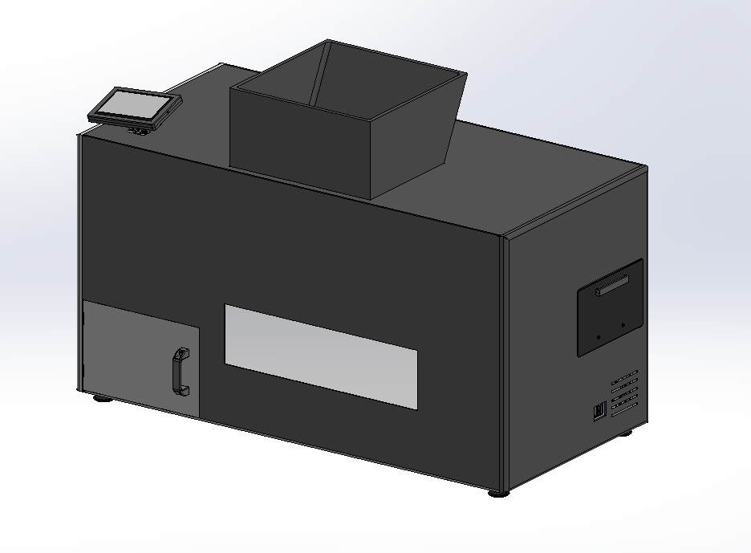
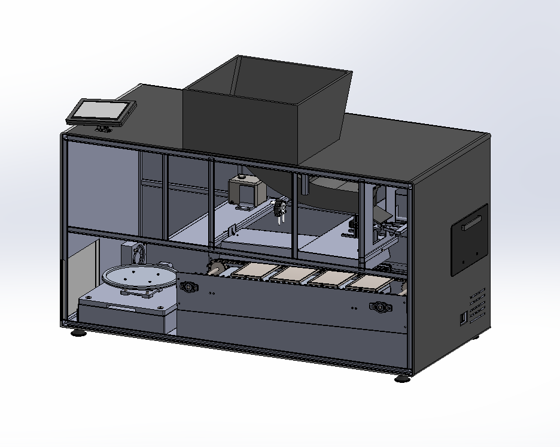
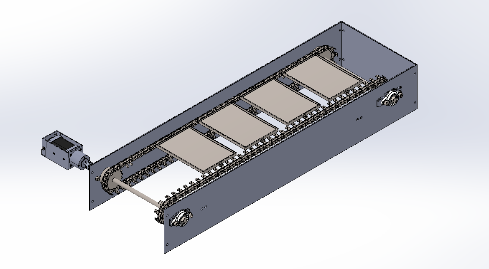
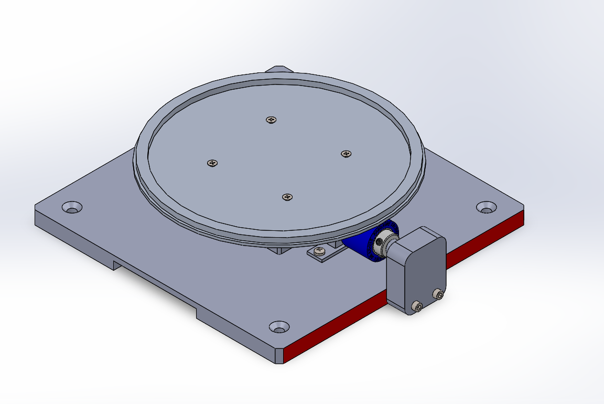
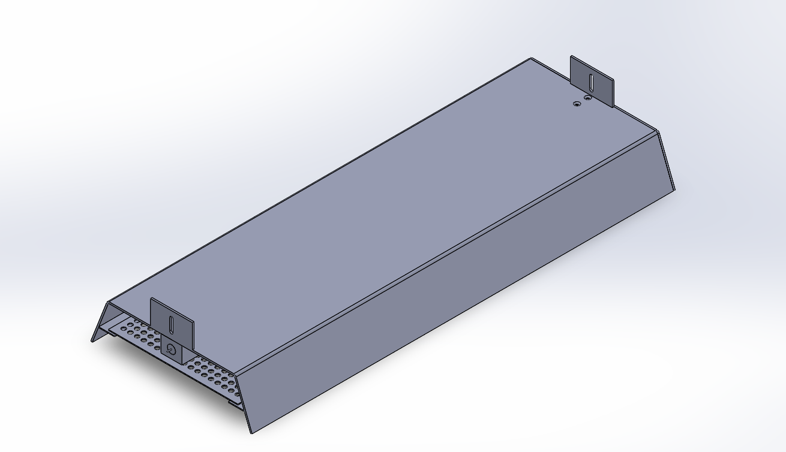
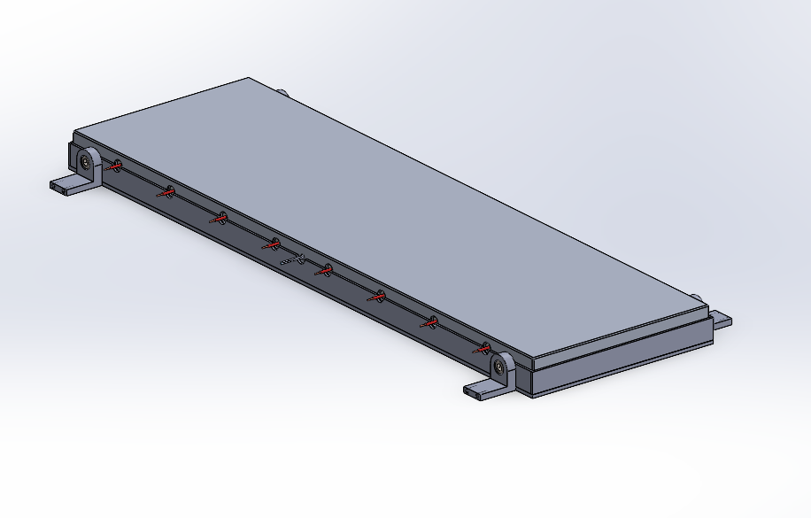
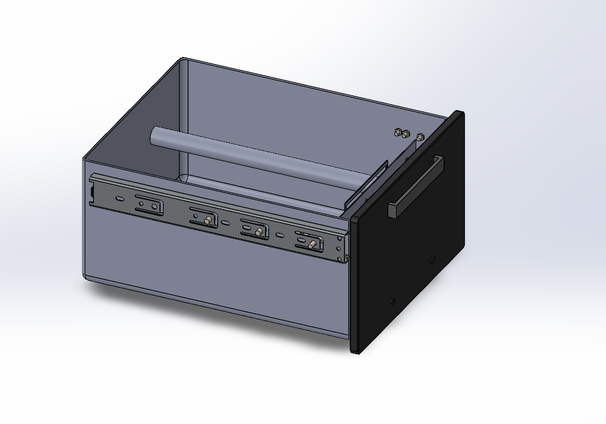
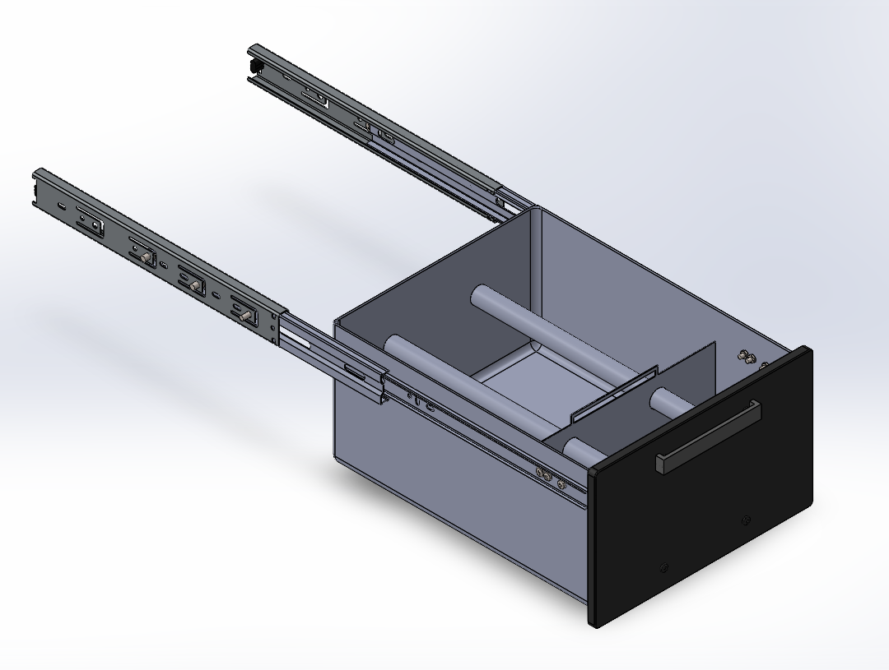
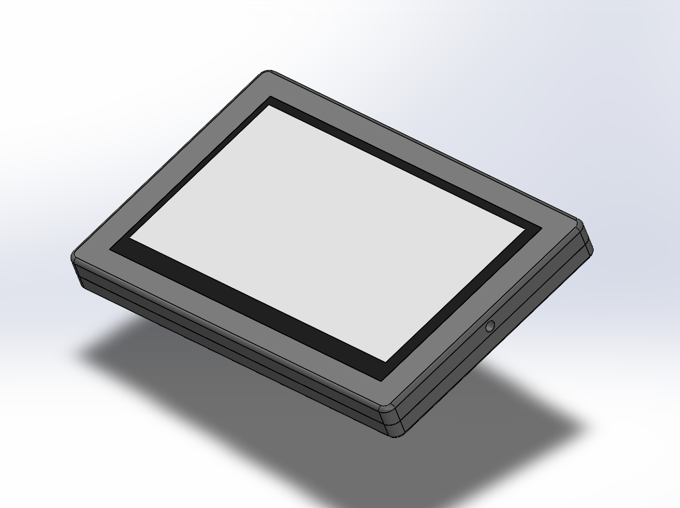
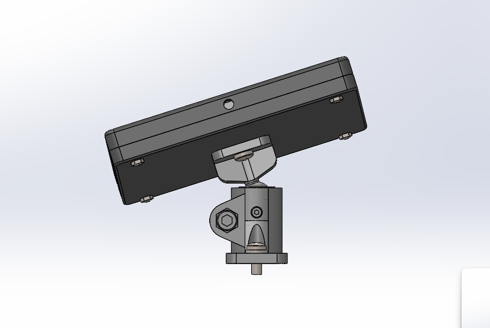

# SunnyPro - Automated Egg-Frying Machine

SunnyPro is a university team product-development project for an automated sunny-side-up egg-frying machine intended for hotel breakfast and buffet service. The concept combines egg storage and cracking, oil dosing, conveyor transport, top and bottom heating, eggshell collection, and a rotating serving platform.

  

<em>Complete machine CAD assembly. No prototype was manufactured.</em>

## Project requirements and constraints

These requirements come from the project brief and are design targets, not measured results.

| Area | Requirement |
|---|---|
| Order size | Select between one and four eggs |
| Preparation time | Each egg within 30 seconds; complete order within five minutes |
| Throughput | At least 120 eggs per hour during continuous operation |
| Raw-egg storage | At least 60 eggs |
| Processing | Open and cook whole raw eggs inside the machine |
| Egg quality | Preserve the sunny-side-up appearance and yolk; target failure rate no greater than 5% |
| Refilling and waste | Refill during operation and collect eggshells separately from the food path |
| Installation | Countertop installation with a maximum depth of 600 mm |
| Power | The brief allowed a 230 V or 400 V mains supply |
| Hygiene and maintenance | Consider food-contact surfaces, cleanability, removable parts, and waste removal |
| Appearance | Develop an enclosure suitable for a customer-facing breakfast station |

The project covered design and engineering documentation. No parts were manufactured or physically tested. See the [original requirements](docs/requirements/SunnyPro_Requirements.pdf).

## My contribution

My main responsibility was the mechanical CAD and the engineering work behind the subsystems I developed. For each of these systems, I selected the components and performed the functional calculations, including motor speed, transmission ratio, load, and drive requirements where applicable.

I designed the conveyor and drive integration, rotating serving platform, top and bottom heating assemblies, eggshell collection drawer and compression mechanism, oil tank, and complete display casing and mounting assembly.

Beyond the CAD, I:

- Contributed to the product concept and developed the overall machine appearance and enclosure concept.
- Created the functional structure block diagram and wrote the full machine workflow explanation.
- Selected materials and independently prepared the manufacturing-technology documentation.
- Prepared the final BOM and the technical assembly drawings.
- Contributed to heating calculations and the D-FMEA; the D-FMEA was mainly my teammates' work.
- Supported my teammate with the solenoid-operated mechanisms and egg tunnel.

My teammate produced the freehand concept sketch, implemented the main enclosure and structural frame in CAD, and led the gate, tunnel, and solenoid mechanisms. Purchased-component models and simplified placeholders are distinguished from custom parts in the supporting notes.

  

## Functional structure and workflow

I used the functional block diagram to define the machine boundary and connect material flow, energy supply, sensing, actuation, and control.

The intended workflow is:

1. Load raw eggs and oil, install the eggshell drawer, and check removable parts.
2. Initialise the machine, establish reference positions, and preheat the cooking area.
3. Accept an order for one to four eggs.
4. Release and crack individual eggs, sending their shells to the drawer.
5. Dose oil onto the cooking plates and transport the egg contents through the heating zone.
6. Transfer the cooked eggs to the serving area and index the rotating platform.
7. Continue operation, replenish consumables, remove waste when appropriate, and enter standby or shutdown.

This is a design description of the intended sequence. The [functional structure and workflow PDF](docs/system-design/SunnyPro_Functional_Structure_and_Workflow.pdf) preserves the full diagram and explanation.

## Mechanical subsystem development

### Conveyor and drive

I designed the two-chain conveyor carrying four cooking plates, including sprockets, drive and idler shafts, bearing supports, side structures, and motor/gearbox/encoder integration. I selected the components and related the intended linear speed to shaft speed, transmission ratio, and drive loading.

  

### Rotating serving platform

I designed the rotating plate, bearing and load-cell support arrangement, common support platform, motor casing, friction drive, and microswitch reference arrangement. The calculations cover the intended indexing movement, rotational speed, transmission ratio, and load.

  

### Top and bottom heating

I designed the upper infrared shield from scratch, including its mounting features, internal supports, and protective perforated sheet. The purchased quartz heating element is represented by a simplified CAD model.

For the bottom heating system, I designed the aluminium block, cartridge-heater and sensor arrangement, support frame, and mounting brackets. I selected the associated components and materials and contributed to the heating calculations.

  
  

### Eggshell collection and oil storage

I designed the sliding eggshell drawer and movable compression plate, including the intended drawer and pressing movements. The arrangement provides access for emptying and cleaning.

  
  

I also designed the oil tank and its mounting arrangement. The supporting documentation includes the proposed oil-dosing components and calculations.

### Display assembly

I designed the complete display casing and mounting assembly, including the front bezel, rear housing, fixing features, and support connection.

  
  

## Materials and manufacturing

I selected materials and documented proposed manufacturing routes, considering heat transfer, corrosion resistance, weight, stiffness, cleanability, geometry, and assembly.

| Part or assembly | Documented approach |
|---|---|
| Lower heating block | Aluminium plate; CNC machining with heater and sensor bores |
| Drawer and heater shielding | Stainless-steel sheet; cutting, forming, welding, and finishing |
| Shafts and mounting parts | Turning, milling, drilling, and threading |
| Selected motor housings | Casting followed by machining of locating and mounting features |
| Display casing | Plastic housing parts with proposed moulding and insert features |

These are manufacturing plans, not completed production operations. The [materials and manufacturing PDF](docs/manufacturing/SunnyPro_Materials_and_Manufacturing.pdf) includes the detailed choices and reasons.

## Final BOM and technical drawings

I prepared the [final BOM](docs/bom/SunnyPro_Final_BOM.pdf), covering custom and purchased parts, materials, quantities, technical information, and assembly references.

I also prepared the [technical assembly drawing](docs/drawings/SunnyPro_Assembly_Drawing.pdf), including section and detail views of the internal layout and mounting interfaces. Its [item key](docs/drawings/SunnyPro_Assembly_Drawing_BOM.pdf) is available separately. It is an assembly drawing rather than a complete set of individual manufacturing drawings.

## Project status

The completed work includes product-development documentation, CAD assemblies, component selection, functional calculations, material and manufacturing selections, the final BOM, and technical assembly drawings.

The moving assemblies were developed for their intended CAD movement. No physical prototype or completed dynamic validation is claimed. Known fastener-hole and thread mismatches require correction before manufacture, and the operating speeds and material descriptions need to be reconciled across the design documentation.

Cooking performance, thermal behaviour, hygiene performance, positioning accuracy, and reliability remain untested. The [design status and limitations](docs/design-status.md) records these points without presenting design targets as measured results.

## Supporting documentation

| Document | Contents |
|---|---|
| [Full team project report](docs/reports/SunnyPro_Full_Project_Report.pdf) | Complete 302-page report, including the wider team's work |
| [Document index](docs/README.md) | Topic PDFs and original report page ranges |
| [System design](docs/system-design.md) | Functional decomposition and intended workflow |
| [Mechanical design and calculations](docs/mechanical-design.md) | Subsystems, components, and calculation context |
| [Materials and manufacturing](docs/materials-and-manufacturing.md) | Material choices and proposed production methods |
| [Component requirements](docs/components/SunnyPro_Purchased_Component_Requirements.pdf) | Original purchased-component requirements tables |
| [Team D-FMEA](docs/risk/SunnyPro_Team_DFMEA.pdf) | Risk analysis, primarily developed by teammates |
| [CAD source access](cad/README.md) | Companion source archive and opening guidance |
| [Image originals](assets/images/README.md) | Full-resolution, unaltered CAD screenshots |

## Skills demonstrated

SolidWorks part and assembly modelling, mechanism design, functional decomposition, component selection, drive calculations, material selection, manufacturing-process planning, BOM preparation, technical assembly drawing, and multidisciplinary product development.
